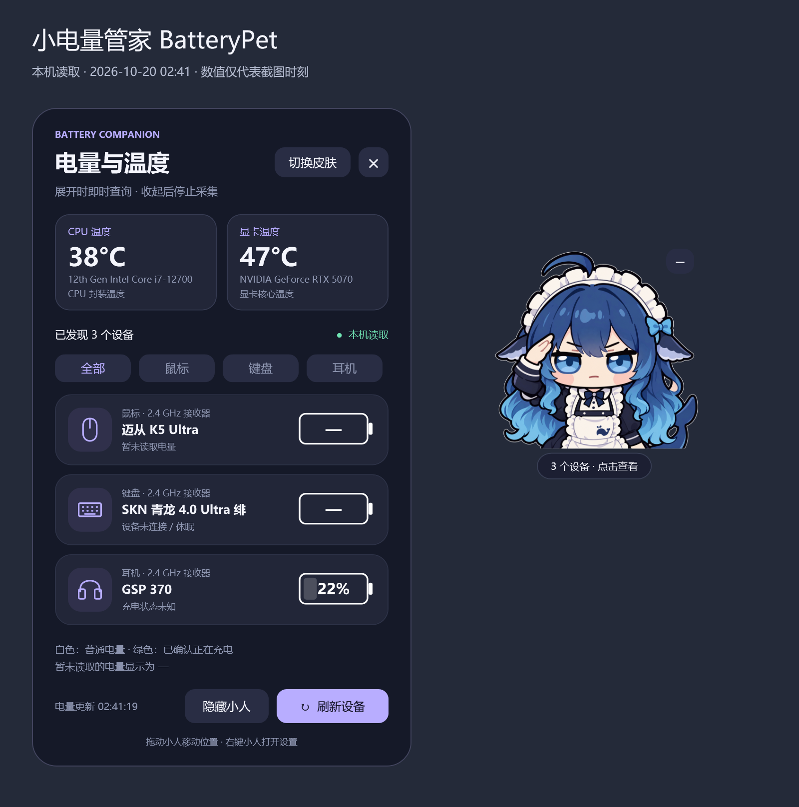
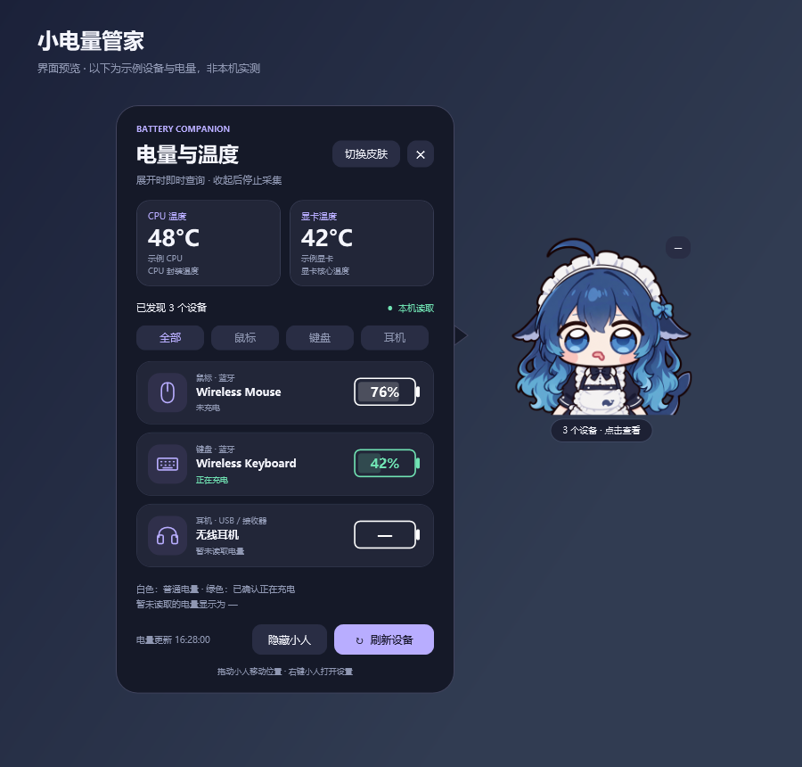

# 小电量管家 BatteryPet

Windows 10 / 11 x64 桌面挂件：点击小人查看无线外设电量、CPU 和显卡温度，支持拖动、托盘、切换皮肤。仅在展开或手动刷新时读取数据，未知值保持未知。

欢迎贡献自己的设备、读取协议、温度后端和皮肤。项目使用 C#、WPF 和 .NET Framework 4.8；日常运行无需管理员权限。

## 界面与效果

### 电量与温度

当前版本的真实 WPF 界面，使用 2026-10-20 本机读取的数据渲染。电量和温度仅代表截图时刻；设备休眠、不在线或协议未返回有效数据时，保留未知值。



### 皮肤与姿态

“大肥鱼”和“菲比啾比”各有日常 / 弹窗两种状态。展开电量与温度弹窗时切换姿态，收起后恢复；选择会保存，重启后保持。


### 充电与未知状态

以下为明确标注的示例界面，用于展示白色普通电量、绿色已确认充电，以及无法读取时的未知状态；不是本机实测数值。



## 主要功能

- 点击小人展开外设电量、CPU 与显卡温度，按鼠标 / 键盘 / 耳机筛选，支持手动刷新。
- 只在展开或刷新时查询，没有周期轮询；隐藏或收起后不继续发起采集。
- 拖动、位置记忆、多显示器可见范围校正、大小调整、置顶、托盘隐藏与恢复、可选开机启动。
- 两套内置皮肤，支持外部皮肤包、弹窗状态切换和淡入过渡。
- 按设备协议读取真实电量，未知值不补零、不猜充电；设备适配和温度后端可独立扩展。

## 先从这里开始

| 你想做什么               | 入口                                                      |
| ------------------- | ------------------------------------------------------- |
| 使用挂件、启用 CPU 温度      | [使用说明](docs/USER_GUIDE.md)                              |
| 了解支持哪些设备            | [设备支持与实机记录](DEVICE_SUPPORT.md)                          |
| 第一次参与贡献             | [贡献指南](CONTRIBUTING.md)                                 |
| 贡献设备名称或电量读取协议       | [设备适配指南](docs/DEVICES.md)                               |
| 贡献 CPU / GPU 温度读取方式 | [温度扩展指南](docs/TEMPERATURES.md)                          |
| 贡献或安装皮肤             | [皮肤指南](docs/SKINS.md)                                   |
| 理解代码、查找修改位置         | [架构说明](docs/ARCHITECTURE.md)                            |
| 构建与测试 / 发布便携包       | [构建说明](docs/BUILDING.md) / [发布仓库说明](docs/PUBLISHING.md) |

## 从源码运行

在 Windows PowerShell 中执行：

```powershell
powershell -NoProfile -ExecutionPolicy Bypass -File .\build.ps1 -Test
.\dist\BatteryPet.exe
```

使用 Windows 自带的 .NET Framework C# 编译器，无需 Node、Python、Visual Studio 或联网恢复依赖。默认构建挂件并运行不访问硬件的自检；已启用的 CPU 温度服务仍可使用。首次构建完整 CPU 服务需单独准备第三方组件，见[构建说明](docs/BUILDING.md)。

## 项目结构

```text
src/
  App/                         程序入口、桌面窗口与查询时机
  Core/                        电量/温度模型、规则、设置和 JSON
  Devices/
    DeviceProviderRegistry.cs  设备适配接口与注册表
    Adapters/                  每种厂商设备独立维护
    Standard/                  标准 BLE / HID 电池读取
  Platform/Windows/            PnP、HID 通信和 Windows 原生接口
  Temperatures/
    ThermalProvider.cs         温度接口、注册与结果校验
    Providers/                 CPU 服务客户端、NVIDIA NVML
  Skins/                       皮肤清单与图片加载
  UI/                          WPF 视图、皮肤菜单
services/thermal/              独立的 CPU 温度 Windows 服务
devices/profiles/              每设备一个名称与身份配置
skins/<skin-id>/               skin.json、PNG、素材授权
schemas/                       设备配置和皮肤的 JSON Schema
examples/                      设备、温度、皮肤贡献模板
tests/                         自检与脱敏协议报文
docs/                          架构、贡献、构建和使用说明
third_party/                   第三方许可证和来源
tools/                         构建辅助、打包和实机验证脚本
.github/                       CI、Issue 和 PR 模板
```

`dist/`、`outputs/`、`research/`、`vendor/`、本地虚拟环境和二进制包通过 `.gitignore` 排除。源码构建不依赖个人的 `research/` 目录。

## 扩展方式

- **设备**：在 `src/Devices/Adapters/` 添加 `IHidBatteryAdapter` 或 `IPhysicalBatteryAdapter` 实现，在注册表登记，并附上脱敏报文和测试。名称配置本身不会产生电量数据。
- **温度**：实现 `ITemperatureProvider` 并登记；界面复用统一结果。当前提供 CPU 的 LibreHardwareMonitor / PawnIO 服务，以及 NVIDIA NVML；AMD / Intel 显卡后端欢迎贡献。
- **皮肤**：添加 `skin.json` 和透明 PNG 即可，不需要改 C#。源码构建自动内嵌仓库中的皮肤；现成 EXE 也可从 `skins/<id>/` 或 `%LOCALAPPDATA%\BatteryPet\skins/<id>/` 读取新皮肤，重启后出现在菜单中。

设备和温度扩展随源码编译，当前不提供运行时 DLL 插件加载。

## 当前支持

已接入 Windows PnP、标准蓝牙电池服务、标准 USB HID 电池特征，以及赛洛斯 V12、迈从 K5 Ultra、GSP 370 的专用读取。SKN 青龙 Ultra 可确认型号和连接状态，百分比仍未知。CPU / GPU 和各连接模式的验证范围见[实机记录](DEVICE_SUPPORT.md)与[使用说明](docs/USER_GUIDE.md)。

## 许可证

原创代码与文档按 [MIT](LICENSE) 开源。皮肤图片及含图片的界面截图不包含在代码 MIT 授权中。项目提供者已确认现有两套图片可随本项目公开，使用范围见各皮肤的 `LICENSE.txt` 与 [NOTICE.md](NOTICE.md)；第三方角色和素材的权利仍归各自权利人。

## 心路历程

个人自用小玩具。主要是觉得 x 大师比较占空间，同时无线设备多了，每次打开不同网页或软件看电量很麻烦，所以做了这个挂件。各个硬件设备的协议不同，目前只适配了自己的部分设备，欢迎大家通过 vibe coding 增加自己的设备支持。
